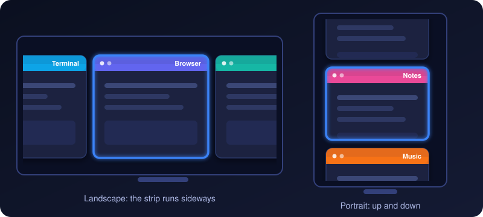

<p align="center">
  
</p>

<p align="center">
  <a href="https://github.com/labrat-26/Planor/releases/latest"><b>⬇ Download planor.exe</b></a>
  &nbsp;·&nbsp; <a href="#-getting-started-in-two-minutes">Get started</a>
  &nbsp;·&nbsp; <a href="#-the-cheat-sheet">Cheat sheet</a>
  &nbsp;·&nbsp; <a href="#-making-it-yours">Settings</a>
  &nbsp;·&nbsp; <a href="#-when-something-goes-wrong">Help</a>
</p>

---

## What is Planor?

Planor tidies your windows for you, and does it in a way that never squeezes them.

Most window managers cram every window onto one screen, so the more you open the smaller they all get. **Planor puts your windows on one long strip that extends past the edge of your screen.** Each window keeps a comfortable size. You slide the strip left and right (or up and down on a portrait monitor) to bring the window you want into view. Some windows belong together? **Stack** them in one slot, then **swipe up or down** to flip through the stack.

<p align="center">
  
</p>

If you have used a phone's home screen, you already know the idea: swipe to see more.

**In short**

- 🪟 **No more tiny windows.** New windows join the strip at a normal size.
- 👆 **Built for touchpads.** Three fingers scroll the strip. Four fingers carry a window.
- 🖱️ **Works with keyboard and mouse too.** Every action has a shortcut.
- 🖥️ **Multi-monitor friendly.** Each monitor has its own strip, and you can throw windows between them.
- 🎯 **Focus your way.** Keyboard, mouse or touchpad moves focus. Optionally let focus follow the mouse, or have the cursor jump to the focused window.
- 🎨 **Borders and gaps you control.** Pick the outline colours, thickness, corner roundness and the space between windows.
- ⌨️ **Your own shortcuts.** Every keyboard shortcut can be changed.
- 🔓 **No admin rights needed.** One file, no installer. It runs as you and keeps its settings in your own profile.
- 🧰 **Invisible when idle.** Planor has no window of its own. It runs quietly in the background and draws only coloured outlines.
- 🛟 **Always an escape hatch.** One shortcut puts every window back exactly where it was.

> **Good to know:** Planor is for **Windows 11** only, and it is a young project. It never touches your files. If you ever want it gone, [one command](#-leaving-or-uninstalling) restores your windows.

---

## 🚀 Getting started in two minutes

1. **Download** `planor.exe` from the [latest release](https://github.com/labrat-26/Planor/releases/latest).
2. **Put it somewhere permanent**, for example `C:\Tools\Planor\planor.exe`.
3. **Open a terminal** (Windows Terminal or PowerShell) in that folder and start it:

   ```powershell
   .\planor.exe start
   ```

   Your open windows slide into place. Planor runs in the background, so you can close the terminal.

4. **Try it.** Press <kbd>Alt</kbd>+<kbd>→</kbd> to move focus to the next window. Open a new app and watch it join the strip.

> 🔓 **No administrator rights needed.** Planor is a single file that runs as your normal user. There is no setup wizard and no "Run as administrator" prompt (the optional Install button just copies the file into your own profile). It keeps its settings in `%APPDATA%\planor`, and `autostart` uses your own per-user startup entry, so nothing system-wide is changed.

That is all. For the smoothest experience, spend five minutes on the [recommended Windows settings](#-recommended-windows-settings-five-minutes-once) below (the main one: turn off Windows' own touchpad gestures). Then the next sections explain what you can do.

### Settings, the tray icon, and starting Planor when you sign in

While Planor runs it shows an icon in the notification area (near the clock). Click it for **Pause**, **Configure** and **Exit**. **Configure** opens the settings window (you can also run `.\planor.exe settings`): every option, the app rules, a colour picker, and an **Install** page. Changes apply right away and match your Windows light or dark theme.

To start Planor with Windows, open **Configure > Install**, press **Install** (this copies Planor to `%LOCALAPPDATA%\Planor` for your user only), then switch on **Start Planor when I sign in**. The same page can uninstall it again.

```powershell
.\planor.exe autostart on     # same switch, but only from the installed copy; "off" undoes it
```

### Stop it any time

```powershell
.\planor.exe stop
```

---

## 🧹 Recommended Windows settings (five minutes, once)

Windows has its own ideas about window layout, and they clash with Planor. These four settings let the two get along. Only the first one needs a manual change. The rest are checks.

### 1. Turn off Windows' own touchpad gestures

Windows reacts to three- and four-finger swipes (Task view, Show desktop, switch desktops) at the same time as Planor does. Planor can only *listen* to the touchpad, so it cannot stop Windows from reacting. Please switch Windows' gestures off by hand:

> **Settings → Bluetooth & devices → Touchpad → Three-finger gestures** and **Four-finger gestures**
> Set every **Swipe** (up, down, left, right) and **Tap** to **Nothing**. On some PCs this lives under **Advanced gestures**.

Use the settings page itself. Editing the registry does not take effect, and the "media" preset makes swipes change your volume.

### 2. Turn off Snap, Snap Assist and the maximize pop-up

Snap would tile windows a second time, and the little layout picker that appears when you hover over a window's **maximize** button is Snap too.

- **Planor does this for you.** While it runs it switches off Snap windows, Snap Assist, the maximize-button layout picker, the snap bar and joint resizing. When you run `planor.exe stop` it puts your original choices back.
- **To do it yourself,** open **Settings → System → Multitasking** and switch **Snap windows** off. That turns the sub-options off too.

If you ever see the layout picker again, run `planor.exe stop` and `planor.exe start`.

### 3. Give each screen's taskbar only that screen's windows

With several monitors, you want the taskbar on each screen to show only the windows that live on that screen.

> **Settings → Personalization → Taskbar → Taskbar behaviors**
> - **Show my taskbar on all displays:** *On*
> - **When using multiple displays, show my taskbar apps on:** **Taskbar where window is open**

Now the strip on each monitor and the taskbar below it tell the same story.

### 4. Stay on one virtual desktop

Planor's strip already does the job virtual desktops usually do, and windows hidden on another desktop are easy to forget about. Windows has no switch to turn virtual desktops off, but you can make them disappear from your day:

- **Hide the Task view button:** **Settings → Personalization → Taskbar → Taskbar items → Task view: Off**.
- **Close the extra desktops:** open Task view (<kbd>Win</kbd>+<kbd>Tab</kbd>), hover over each extra desktop and click the **×**. Windows moves their windows to the desktop you stay on.
- **Show everything everywhere:** in **Settings → System → Multitasking → Desktops**, set the taskbar and <kbd>Alt</kbd>+<kbd>Tab</kbd> to show windows from **all desktops**.
- **Avoid the gestures and shortcuts** that switch desktops (<kbd>Win</kbd>+<kbd>Ctrl</kbd>+<kbd>←</kbd>/<kbd>→</kbd>). Step 1 already removes the touchpad ones.

---

## 🎬 How it works, in pictures

### 1. Scroll the strip

**On a touchpad,** slide **three fingers sideways**. The strip follows your fingers, and the window nearest the middle becomes the focused one. A fast swipe keeps gliding for a moment after you lift, like a phone list.

**With a mouse,** hold <kbd>Win</kbd> and turn the **mouse wheel**. Every notch moves the strip one fixed step. Watch the animation: the touchpad turns into a mouse halfway through to show the second way.

<p align="center">
  
</p>

Keyboard only? <kbd>Alt</kbd>+<kbd>←</kbd> / <kbd>→</kbd> moves focus along the strip, and the strip scrolls to follow.

### 2. Stack windows together

Sometimes two windows belong in one place, such as a chat beside its notes. **Stacking** puts them in one slot, and you flip between them.

Pick a window up with **four fingers** (or drag it with the mouse), then drop it on another window:

- **Green middle zone** (the middle half of the window): the two **stack**. The outline turns purple.
- **Anywhere else on the window:** the two **swap** places.
- **Hold <kbd>Shift</kbd> while dropping:** nothing happens and the window goes back to its slot.

<p align="center">
  
</p>

Press <kbd>Alt</kbd>+<kbd>S</kbd> to stack or unstack the focused window.

**Switching inside a stack.** Once windows are stacked, the slot shows them as a **vertical list**. The purple box marks the one you are looking at. **Swipe three fingers up or down**, or press <kbd>Alt</kbd>+<kbd>↓</kbd> / <kbd>Alt</kbd>+<kbd>↑</kbd>, to move the selection, and the window in the slot changes with it. With a mouse, hold <kbd>Win</kbd>+<kbd>Shift</kbd> and turn the wheel.

<p align="center">
  
</p>

### 3. Vertical (portrait) monitors work too

Planor reads each monitor's orientation. On a **landscape** monitor the strip runs sideways. On a **portrait** monitor it runs **up and down**, so you scroll the other way. Stacking, pinning and flinging work the same way.

The animation shows a portrait monitor on the left and a landscape one on the right:

1. The landscape strip scrolls sideways.
2. A window is **thrown onto the portrait monitor**.
3. You **browse the portrait strip** up and down.

<p align="center">
  
</p>

Hold <kbd>Win</kbd> and turn the mouse wheel to scroll a portrait strip up and down. <kbd>Alt</kbd>+<kbd>↑</kbd> / <kbd>↓</kbd> steps focus along it.

### 4. New windows tile themselves, and travel between monitors

You never have to arrange anything. Planor decides the layout as windows open, on landscape and portrait monitors alike. Below, both monitors get the same three apps at the same moments (on the portrait one, the split is top and bottom):

1. **Nothing open:** an empty screen, and nothing to do.
2. **First window:** it fills the screen.
3. **Second window:** the screen splits in half, one window each.
4. **Third window and beyond:** each new window joins the strip at the same comfortable size. The strip scrolls to bring it into view, and the older windows wait just off-screen.

<p align="center">
  
</p>

Close a window and the others close the gap. Want a different split or size? Change `default_tile_share` and `first_pair_split` in the [settings](#-making-it-yours).

**Not on the right monitor?** New windows open on the monitor under your mouse pointer, and you can move them to another monitor any time. Carry a window with four fingers and **flick** it sideways as you lift. It flies to the neighbouring monitor. In the animation, the portrait monitor sits on the left: the window is flicked onto it, then flicked back to the landscape monitor.

<p align="center">
  
</p>

You can also slide it across slowly, or press <kbd>Alt</kbd>+<kbd>]</kbd> and <kbd>Alt</kbd>+<kbd>[</kbd> to jump focus between monitors.

### 5. What the coloured outlines mean

| Outline | Meaning |
|---|---|
| 🔵 **Blue** | This is the window you are working in |
| 🟣 **Purple** | The window is part of a stack |
| 🟠 **Orange** | The window is *pinned* (it stays on screen while the strip scrolls) |
| 🟢 **Green** | A drop target while you are dragging |

The thin slivers at the screen edges are **peeks**. They show that more windows wait just off-screen. Click one to bring that window in.

---

## 📋 The cheat sheet

### Keyboard

| Shortcut | What it does |
|---|---|
| <kbd>Alt</kbd>+<kbd>←</kbd> / <kbd>→</kbd> | Focus the previous / next window |
| <kbd>Alt</kbd>+<kbd>↑</kbd> / <kbd>↓</kbd> | Focus the window above / below |
| <kbd>Alt</kbd>+<kbd>Shift</kbd>+<kbd>←</kbd> / <kbd>→</kbd> | Move the focused window along the strip |
| <kbd>Alt</kbd>+<kbd>S</kbd> | Stack / unstack the focused window |
| <kbd>Alt</kbd>+<kbd>P</kbd> | Pin / unpin the focused window |
| <kbd>Alt</kbd>+<kbd>]</kbd> / <kbd>[</kbd> | Focus the next / previous monitor |
| <kbd>Ctrl</kbd>+<kbd>Alt</kbd>+<kbd>Shift</kbd>+<kbd>Backspace</kbd> | **Panic button.** Quit and restore every window |

### Touchpad (precision touchpads)

| Gesture | What it does |
|---|---|
| **3 fingers**, swipe sideways | Scroll the strip live (with momentum) |
| **3 fingers**, swipe up or down | Step focus up or down |
| **4 fingers**, swipe | Pick up the focused window and carry it |
| **4 fingers**, flick as you lift | Throw it to the next monitor |
| **5 fingers** (whole hand) | Cancels a gesture in progress, so a resting palm cannot drag a window |

### Mouse

| Action | What it does |
|---|---|
| <kbd>Win</kbd> + wheel | Scroll the strip under the pointer |
| <kbd>Win</kbd>+<kbd>Shift</kbd> + wheel | Roll through the focused stack |
| Drag a window by its title bar, drop on another | Swap or stack (see above) |
| Click a peek at the screen edge | Bring that window into view |

### Commands

Run these from a terminal with `planor.exe <command>`.

| Command | What it does |
|---|---|
| `start` / `stop` | Start or stop Planor |
| `pause` / `resume` | Pause tiling, then pick it back up |
| `pin` | Pin or unpin the focused window |
| `pull-orphans` | Fetch back any window that got lost off-screen |
| `reload` | Re-read your settings file |
| `settings` (also `config`) | Open the settings window |
| `autostart on` / `off` | Start with Windows, or don't (needs the installed copy; the window's Install page does the same) |
| `state --json` | Show what Planor currently thinks of your windows |

---

## 🎛️ Making it yours

### The settings editor

```powershell
.\planor.exe config
```

A simple screen opens in your terminal. Move with the arrow keys, change a value, and it explains each setting as you go. It checks your input and tells the running Planor to apply changes right away.

### Or edit the file

Settings live in a plain text file: `%APPDATA%\planor\planor.toml`. Every option and its explanation is in [`planor.example.toml`](planor.example.toml). You only need to write the lines you want to change.

A few favourites:

```toml
[layout]
gap_px = 12                 # more breathing room between windows
default_tile_share = 0.6    # new windows take 60 % of the screen width

[borders]
focused_color = "#F43F5E"   # a rose-coloured focus outline

[animation]
duration_ms = 120           # snappier

[hotkeys]
focus_left  = "Win+Left"
focus_right = "Win+Right"
```

### Focus: how Planor follows you

Focus is the window that receives your typing. You can move it with <kbd>Alt</kbd> + arrows, with touchpad gestures, or by clicking. Three more options in the `[layout]` section change how it behaves:

```toml
[layout]
focus_follows_mouse = true        # the window under the pointer takes focus
warp_cursor_to_focused = true     # the pointer jumps to a window when you focus it by keyboard
spawn_on_cursor_monitor = true    # new windows open on the monitor the pointer is on
```

All three are optional. Turn on only the ones you like.

### Borders and gaps

The coloured outlines and the space between windows are yours to tune:

```toml
[layout]
gap_px = 6                  # space between windows, in pixels

[borders]
enabled = true
width_px = 2                # line thickness
corner_radius_px = 8        # 0 = square corners
focused_color = "#3B82F6"   # also: stacked_color, pinned_color, drop_target_color
```

Prefer no outlines at all? Set `enabled = false`.

### Your own keyboard shortcuts

Every shortcut in the [cheat sheet](#-the-cheat-sheet) can be changed in the `[hotkeys]` section, or in `planor.exe config`. Write a shortcut as modifiers and a key joined by `+`:

```toml
[hotkeys]
focus_left   = "Ctrl+Alt+Left"
focus_right  = "Ctrl+Alt+Right"
stack_toggle = "Alt+G"
toggle_pin   = "Alt+P"
```

The names you can set are `focus_left`, `focus_right`, `focus_up`, `focus_down`, `move_left`, `move_right`, `stack_toggle`, `toggle_pin`, `focus_monitor_next`, `focus_monitor_prev` and `panic_exit`. Changes apply as soon as you save, or run `planor.exe reload`. A shortcut another app already uses will not register, so pick a different one.

### Windows Planor should leave alone

Some programs should never be tiled, such as a task manager or a video call popup. Add a rule:

```toml
[[rules]]
process = "Taskmgr.exe"
action = "ignore"
```

Fullscreen apps are handled for you: the strip steps aside while they are fullscreen.

---

## 🛟 When something goes wrong

| Problem | Try this |
|---|---|
| **Everything looks odd and I want out** | Press <kbd>Ctrl</kbd>+<kbd>Alt</kbd>+<kbd>Shift</kbd>+<kbd>Backspace</kbd>. Every window goes back to where it was |
| **A window vanished** | `planor.exe pull-orphans` |
| **A shortcut conflicts with another app** | Change it in `planor.exe config` |
| **Task view or "Show desktop" pops up when I swipe** | Windows' own gestures are still on. See [Recommended Windows settings](#-recommended-windows-settings-five-minutes-once), step 1 |
| **The layout picker shows when I hover maximize** | Snap is back on. Turn it off in **Settings → System → Multitasking**, or restart Planor |
| **Gestures do nothing** | They need a *precision touchpad*. Make sure `three_finger_enabled = true`. The keyboard and mouse still work |
| **I want to see what's happening** | `planor.exe diag on`, reproduce the problem, then `planor.exe diag export <folder>` |
| **It feels slow** | `planor.exe perf` prints timings you can share in an issue |

Found a bug or have an idea? Please [open an issue](https://github.com/labrat-26/Planor/issues). Attach the output of `planor.exe state --json` if you can.

## 👋 Leaving or uninstalling

```powershell
.\planor.exe autostart off
.\planor.exe stop        # windows are put back where they were
```

Then delete `planor.exe` and, if you like, the `%APPDATA%\planor` folder. Nothing else is installed.

---

## 🧑‍💻 For the curious and for contributors

Planor is written in **Rust** and talks to Windows directly, with no extra runtime to install.

```powershell
git clone https://github.com/labrat-26/Planor.git
cd Planor
cargo build --release          # produces target\release\planor.exe
powershell -NoProfile -ExecutionPolicy Bypass -File scripts\verify.ps1 -Tier unit   # quick tests
```

| Where | What is there |
|---|---|
| `src/` | The daemon, layout engine, overlay renderer and Windows glue |
| `tests/` | Unit tests plus live desktop scenario tests |
| `tools/planor-rec/` | A screen recorder and analyzer used to check animations |
| `docs/` | [Architecture](docs/ARCHITECTURE.md), [test plan](docs/TEST_PLAN.md) and design notes |
| [`CHANGELOG.md`](CHANGELOG.md) | What changed in each version |

The live tests drive your real desktop, so do not touch the machine while they run. [`CLAUDE.md`](CLAUDE.md) explains the test workflow in more detail.

---

<p align="center"><sub>Made with care for people who open too many windows. 💙</sub></p>
