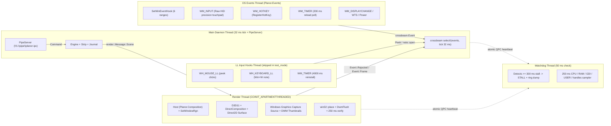

# Planor Architecture Reference

Guide for agents working on Planor (Windows 11 headless scrolling tiling window manager, Rust 2024). Every detail below is verified against `src/`.

## Thread & Dataflow Overview

## Thread Responsibilities

1. **Main Daemon Thread** (`src/daemon.rs::run`, COM `COINIT_MULTITHREADED`, parameterized `Engine<B: WindowBackend>` via `src/backend.rs::Win32Backend`):
   - Acquires single-instance mutex `Local\Planor.Daemon[-<PLANOR_INSTANCE>]` and creates non-blocking named pipe `\\.\pipe\planor-ipc[-<PLANOR_INSTANCE>]`.
   - On startup, restores any leftover `recovery.json`, runs `win32::tweak_system` (only when `PLANOR_INSTANCE` is unset), loads merged config, runs `Engine::topology()`, scans existing windows (unless `tile_existing_on_startup = false`, batching `Journal::save` once across the initial scan), and runs the main loop:
     - Calls `engine.layout()` when `dirty` is true — both at the top of the loop (for event wakeups) and immediately after `server.poll()` (for zero-wait IPC hotkey/command dispatch).
     - Polls `PipeServer::poll()` for IPC commands (`stop`, `reload`, `pause`, `resume`, `pin`, `pull-orphans`, `diag`, `state`, `perf`, `key`).
     - `crossbeam_channel::select!` over `events` (from `win32::events` & `render`) and a **32 ms** `tick` timer (`Engine::tick`, with monitor enumeration throttled to **500 ms** and virtual-desktop checks to **150 ms**).
   - **Simulated Backend** (`src/backend.rs::sim::FakeBackend` + `src/sim_tests.rs`): implements `WindowBackend` over `Arc<Mutex<SimDesktop>>`, enabling deterministic multi-monitor, display hot-unplug, drag, focus, group, fullscreen, and journal recovery tests in `< 0.5 s` without OS desktop dependencies.
2. **OS Events Thread** (`src/win32.rs::events`, hidden `Planor.Events` message window):
   - Installs `SetConsoleCtrlHandler(ctrl)` (blocks up to **4500 ms** polling `SHUTDOWN_DONE` so console close/shutdown restores windows before process termination).
   - Calls `WTSRegisterSessionNotification` (session lock/unlock via `WM_WTSSESSION_CHANGE`).
   - Registers raw HID precision touchpad sink (`usUsagePage = 13`, `usUsage = 5`, `RIDEV_INPUTSINK`) unless `test_mode()`.
   - Registers `[hotkeys]` via `RegisterHotKey` (`input::bindings`) unless `test_mode()`; a **200 ms** `WM_TIMER` re-applies bindings on `Command::Reload`.
   - Hooks 6 `SetWinEventHook` ranges (`WINEVENT_OUTOFCONTEXT | WINEVENT_SKIPOWNPROCESS`): `EVENT_SYSTEM_FOREGROUND`, `EVENT_OBJECT_SHOW..HIDE`, `EVENT_OBJECT_LOCATIONCHANGE`, `EVENT_OBJECT_DESTROY`, `EVENT_SYSTEM_MINIMIZESTART..END`, `EVENT_SYSTEM_MOVESIZESTART..END`.
3. **Low-Level Input Hooks Thread** (`src/win32.rs::events`, skipped when `test_mode()`):
   - Dedicated thread so LL hooks never block on HID parsing or window enumeration.
   - Installs `WH_MOUSE_LL` (intercepts left clicks inside `win32::PEEKS` and emits `Event::Peek(hwnd)`) and, when diagnostics are enabled, `WH_KEYBOARD_LL` (intercepts `Win+W` -> `note::open()` and injects dummy `0xE8` key up/down so Start Menu does not pop).
   - **4000 ms** `WM_TIMER` uninstalls and reinstalls both hooks because Windows silently drops hooks that ever stall or across session transitions.
4. **Render Thread** (`src/render.rs::start`, COM `COINIT_APARTMENTTHREADED`):
   - Maintains one `Host` (`Planor.Composition` popup window, `WS_EX_LAYERED | WS_EX_TRANSPARENT | WS_EX_TOOLWINDOW | WS_EX_TOPMOST | WS_EX_NOACTIVATE`) per monitor bounds `m.2`.
   - `WS_EX_TRANSPARENT` makes every pixel click-through to the taskbar and underlying apps; `WM_NCHITTEST` cannot forward cross-process clicks on Windows.
   - Owns D3D11 + DirectComposition + Direct2D `Surface` (with cached RGB `ID2D1SolidColorBrush` instances) for drawing borders and WGC (`GraphicsCaptureItem`) backing bitmaps (`Source`), plus `DwmRegisterThumbnail` handles for DWM stand-in thumbnails. Caches failing WGC `Source::new` keys for a **5 s** cooldown (`failed_sources`) so un-capturable windows do not stall subsequent warm scenes.
   - Uses adaptive `recv_timeout` (`0 ms` animating, `33 ms` idle with active sources/verify, `50 ms` idle otherwise), animates active `Scene` at monitor refresh cadence (`DwmFlush()`), and preempts immediately whenever `render::EPOCH` advances.
   - Schedules post-settle `verify` **250 ms** after `t >= 1.0` (up to **2** corrective passes) for windows whose DWM extended frame transiently mismatched on uncloak/desktop switch.
5. **Watchdog Thread** (`src/watchdog.rs`):
   - Polls atomic QPC heartbeats for `daemon` and `render` every **50 ms**; emits `STALL <thread> <ms> span=<span_name>` if no progress occurs for **>= 300 ms** (configurable via `PLANOR_STALL_MS`), and triggers a stall capture bundle (plus `planor-rec dump` if ring recorder is running).
   - Samples process/thread CPU, working set, GDI/USER object counts, and OS handles every **250 ms** for `perf`.
6. **Optional Auxiliary Threads**:
   - `record_input()` (`src/daemon.rs`, every **15 ms**, only when `diagnostics.enabled = true && !test_mode()`): polls `GetCursorPos` and `GetAsyncKeyState` for `IN` trace lines (text keys counted, never named).
   - `note::open()` (`src/note.rs`): spawns one transient thread per `Win+W` note UI (`Planor.Note`).

## Tile Rect vs OS Outer Rect

- Windows 11 top-level windows have invisible resize shadow margins (~7 px on left/right/bottom).
- **Tile rect** (`win32::frame(id)`): queries `DwmGetWindowAttribute(..., DWMWA_EXTENDED_FRAME_BOUNDS, ...)` (falling back to `GetWindowRect`). All layout math in `src/core.rs` (`Strip`, `Rect`) and `EXPECT` / `PLACE` trace lines operate on **extended frame coordinates**.
- **OS rect compensation** (`win32::place`): computes inset delta `full - vis` from `GetWindowRect` vs `win32::frame` and shifts/resizes the outer window via `BeginDeferWindowPos` -> `DeferWindowPos(..., SWP_NOACTIVATE | SWP_NOZORDER | SWP_NOOWNERZORDER)` -> `EndDeferWindowPos` so the visible frame lands at the exact tile rect.

## Parked Windows, DWM Stand-Ins, and WGC Bitmaps

- **Park X coordinate**: `park = s.monitors.iter().map(|m| m.2.x + m.2.w).max().unwrap_or(0) + 1024`.
- **When a real window is parked (`proxy = true`)**: any non-pinned tile that is `moving` (`t < 1.0 && origin != target`), clipped by `bound` (`clip != Some(rs)`), a stack `preview`, or `hidden` (stack member beyond active +/- 1) has its real HWND moved off-screen to `(park, tile.rect.y)` while the overlay host renders its stand-in clipped to `bound`:
  - **WGC bitmap (`Source`)**: captured at the window's content size and drawn onto the Direct2D `Surface` at `rs` (keeping `o.w, o.h` constant while sliding so contents do not stretch during size changes).
  - **DWM thumbnail (`Host::thumbnail`)**: live DWM composition thumbnail cropped to `clip`, hidden during motion when a WGC bitmap exists so the bitmap and thumbnail do not double-draw.
- **`SetPeeks`**: whenever `proxy && !moving && !full`, the clipped rectangle is published to `win32::PEEKS` so the `WH_MOUSE_LL` hook turns clicks on peek slivers into `Event::Peek(hwnd)`.

## Overlay Holes (`SetWindowRgn`, 200 ms poll)

- Unmanaged visible top-level windows (`win32::external(w)` true and `self.owning(w).is_none()`, e.g., Task Manager or `action = "ignore"` rules) must never be covered by Planor's topmost overlay.
- `Engine::holes()` enumerates unmanaged windows intersecting any monitor bounds; `Engine::tick()` polls `self.holes()` every **200 ms** and marks `self.dirty = true` if the list changed.
- In `render.rs`, each `Host` cuts matching monitor-intersected rectangles out of its overlay HWND via `CreateRectRgn` + `CombineRgn(..., RGN_DIFF)` + `SetWindowRgn(host.h, whole, 1)` (only re-applied when the host's hole list changes).
- In isolated instances (`!PLANOR_INSTANCE.is_empty()`), `Engine::holes()` skips general desktop apps unless `PLANOR_HOLES=<ClassName>` is set, avoiding false cut-outs from the developer's background windows.

## Touchpad Gesture Pipeline

1. `WM_INPUT` (`win32::proc`) -> `input::contacts(l)` parses HID precision touchpad usages (page 13 link collections, contact count `0x54`, tip switch `0x42`, contact ID `0x51`, X/Y `0x30`/`0x31`), converts to pixel-scaled units using `cursor_dpi()` (`MonitorFromPoint` + `GetDpiForMonitor` — never `WindowFromPoint` so hung apps cannot stall input).
2. `core::ContactFrame::packet` assembles split/hybrid HID contact reports into complete 3- or 4-finger frames.
3. `core::Gesture::sample` classifies:
   - **3 fingers**: picks axis after a tiny deadzone (`deadzone.min(3.0)`), emitting `Swipe::Scroll(dx)` sideways, `Swipe::ScrollV(dy)` vertically, and `Swipe::ScrollEnd` on lift.
   - **4 fingers**: after `deadzone` distance, emits `Swipe::DragStart`, `Swipe::DragMove(dx, dy)`, and `Swipe::DragEnd`.
4. `Engine` handling (`src/daemon.rs`):
   - **3-finger horizontal (`pad_scroll` / `scroll_by`)**: un-eased 1:1 `Strip::scroll` (`self.instant = true`) + `Strip::focus_nearest_center()`. On lift (`pad_scroll_end`), launches `inertia` (decay `0.9^(dt/0.032)`) if recent velocity > 150, else schedules `pad_settle` in **220 ms** (or **120 ms** after inertia ends).
   - **3-finger vertical**: `Strip::roll` through stack deck (`settle_roll` on settle), or if not in a stack, monitor hop after 90 units of travel.
   - **4-finger drag (`pad_begin` / `pad_move` / `pad_end`)**: grabs active window at center, moves cursor + window via rate-limited (**8 ms**) async `SetWindowPos(..., SWP_ASYNCWINDOWPOS)`, and on lift triggers cross-monitor cursor-only fling if lift speed >= `swipe_fling_speed` before running `drag_end`.

## Config Merge & Reload

- `src/main.rs::config()` ensures `%APPDATA%\planor\planor.toml` exists (seeded from embedded `include_str!("../planor.example.toml")`).
- `parse()` loads the embedded `planor.example.toml` as defaults, then merges every key from `%APPDATA%\planor\planor.toml` with type/range checks (`0..=100000` for ints, finite `> 0` for floats, `#RRGGBB` hex for `*_color`, known enums for `curve` and `drag_stack_modifier`).
- `[[rules]]` in user config replaces the default `rules` array wholesale (each entry must have valid `action` in `ignore|float|tile` and at least `process` or `class`).
- `planor reload` re-reads config, bumps `config_version`, forwards updated config to `win32::events` over `reload` channel to rebind hotkeys, updates strip gaps, and triggers layout.

## Recovery Journal & System Tweaks

- **Journal** (`%LOCALAPPDATA%\planor\recovery.json`): `Journal::capture(hwnd)` records `pid`, unique `cookie` (also attached as HWND property `Planor.Recovery.Identity`), `WINDOWPLACEMENT`, `GetWindowRect`, and `WS_EX_TOPMOST` before tiling, persisting atomically via `recovery.tmp` -> `sync_all()` -> `fs::rename`.
- **Restore**: `Journal::restore()` validates `pid` and `Planor.Recovery.Identity` cookie on every entry, applies `SetWindowPlacement` + `SetWindowPos`, removes the property, and deletes `recovery.json` once empty. Stale dead entries are pruned automatically.
- **Shutdown & Crash Rescue**: `Command::Stop`, `Event::Stop`, `panic_exit`, and `CTRL_*` restore all journaled windows before exit (`SHUTDOWN_DONE`). If the daemon was killed (`SIGKILL`/Task Manager), `planor stop` calls `daemon::recover()` directly from CLI, and the next `planor start` restores any journal at startup before tiling.
- **System Tweaks** (`win32::tweak_system`): disables Windows Snap Assist / JointResize in HKCU (backing up original values to `%LOCALAPPDATA%\planor\system-settings.json`, skipped when `PLANOR_INSTANCE` is set) and restores them on stop/recover.

## Trace Line Glossary (`%LOCALAPPDATA%\planor\trace.log`)

Lines are stamped with UTC wall clock `HH:MM:SS.mmm` (`trace.prev.log` holds the previous run):

| Prefix | Meaning |
|---|---|
| `EXPECT id=... rect=x,y,w,h monitor=... kind=tile\|peek\|parked\|fullscreen hidden=0\|1 animate_ms=N` | Target rectangle Planor expects for each window in a scene |
| `SCENE seq=N tiles=N holes=N` | Scene dispatched from daemon to render thread (`seq` monotonically increases per daemon run) |
| `PLACE id (old) -> (new)` | First placement pass per scene when current DWM frame differs from target |
| `FG hwnd managed=bool external=bool pad=bool` | `EVENT_SYSTEM_FOREGROUND` arrival |
| `EV <name> ...` | Dispatched `win32::Event` (`window`, `key`, `topology`, `suspend`, `rejected`, `peek`) |
| `PAD ...` | Touchpad gesture transitions (`contacts`, `scroll`, `DragStart`, `DragEnd`, `ScrollEnd`, `step`) |
| `IN ...` | Polled cursor position / button / non-text key events (text keys aggregated as `IN text-keys xN`) |
| `SLOW <span_or_step> <ms> ...` | Operation exceeding its latency threshold |
| `STALL <thread> <ms> span=<span_name>` | Watchdog detection of daemon or render thread stuck >= 300 ms |
| `INVARIANT <name> 
` | Violated layout or settled-parked invariant |
| `NOTE <text> [bundle=<dir>]` | User dictation submitted via `Win+W` (with attached context bundle path) |
